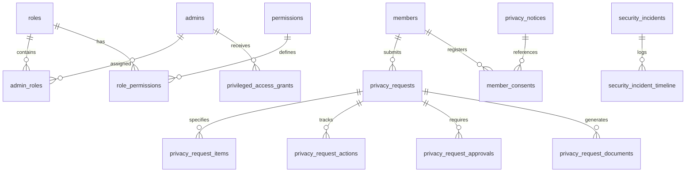

# Database Impact Assessment & Schema Architecture
**PMCC-UK Laravel Application – UK GDPR, Privacy Governance & Security Upgrade**

---

## 1. Principles of Database Engineering

In accordance with strict production requirements:
1. **Zero Destructive Operations**: No `DROP TABLE`, `TRUNCATE`, `migrate:fresh`, or destructive data modifications.
2. **Preservation of Existing Data & Identity**: All member IDs, GUIDs, membership numbers, payment transactions, booking references, and children relationships are strictly preserved.
3. **Additive-First Schema Evolution**: All changes consist of new dedicated governance tables and non-breaking, nullable column additions to existing tables.
4. **Dual-Dialect Compatibility**: All migrations and queries must execute flawlessly on both production MySQL 8 / MariaDB and local/CI SQLite environments.
5. **Rollback Strategy**: Every migration provides a fully tested, symmetric `down()` method that safely reverses additions without impacting core legacy tables.

---

## 2. Existing Schema Preservation Matrix

| Existing Table | Role in Application | Upgrade Impact | Safety Measures |
| :--- | :--- | :--- | :--- |
| `admins` | Administrative users & gate staff | **Additive**: Add foreign relation link for RBAC roles; preserve existing `role` column as fallback. | No columns removed. Existing credentials and 2FA secrets preserved intact. |
| `members` | Primary member records & PII | **Additive**: Add nullable `password` column for self-service Member Privacy Center login. | All existing 32 columns, GUIDs, photos, and timestamps remain untouched. |
| `member_children` | Family dependents under/over 18 | **Unchanged**: Accessed via foreign key `member_id`. | Encrypted casts preserved. Authorization checks applied at controller/policy layer. |
| `renewal_requests` | Historical & pending renewals | **Unchanged**: Retained for audit and operational renewal workflows. | Relational integrity preserved. |
| `renewal_children` | Dependents attached to renewals | **Unchanged**. | Relational integrity preserved. |
| `financial_transactions` | Master accounting ledger | **Preserved with Legal Hold**: Financial transactions are protected by statutory retention rules. | Cannot be deleted by standard erasure requests (Art. 17(3)(b) UK GDPR). |
| `payment_history` | Individual member payments | **Preserved with Legal Hold**. | Linked to members for Subject Access Requests without allowing unilateral deletion. |
| `event_bookings` | Ticket purchases & attendance | **Unchanged**: Subject to privacy-aware export controls. | Anonymization supported upon retention expiry. |
| `activity_logs` | Legacy action logging | **Preserved**: Existing activity logs remain read-only; augmented by `security_audit_logs`. | No table modifications or truncation. |

---

## 3. New Governance & Security Tables

The privacy and governance upgrade introduces 12 additive tables structured under modern Laravel schema conventions:

### 3.1 Access Control & Privilege Management
1. **`roles`**: Defines organizational governance roles (Super Administrator, President, Secretary, Treasurer, Membership Administrator, Privacy Officer, Committee Member, Developer, Member).
2. **`permissions`**: Granular permissions (e.g. `members.view.own`, `members.view.sensitive`, `members.export`, `privacy.requests.review`, `audit.logs.view`).
3. **`role_permissions`**: Pivot linking roles to permissions.
4. **`admin_roles`**: Pivot linking admin accounts to formal roles.
5. **`privileged_access_grants`**: Implements time-limited, audited elevation (break-glass, developer emergency access) with mandatory justification, duration, and automatic expiry.

### 3.2 Subject Access & Privacy Request Management
6. **`privacy_requests`**: Central repository for all UK GDPR rights exercises:
   - Unique alphanumeric reference (e.g. `SAR-2026-0042`, `REC-2026-0019`).
   - Request type (`sar`, `rectification`, `erasure`, `restriction`, `objection`, `portability`, `consent_withdrawal`, `complaint`).
   - Statutory due date (calculated via UK ICO 1-calendar-month rule, accounting for working days & valid extensions).
   - Identity verification state, assigned reviewer, decision, and closure timestamp.
7. **`privacy_request_items`**: Field-level or record-level granularity for rectification, erasure, or objection.
8. **`privacy_request_actions`**: Comprehensive lifecycle log (communications, evidence requests, discovery steps).
9. **`privacy_request_approvals`**: Multi-party independent approvals (e.g. Privacy Officer approval required for erasure or bulk exports).
10. **`privacy_request_documents`**: Securely stored SAR packages, proof documents, and encrypted download tokens.

### 3.3 Data Retention, Consents, Incidents & Auditing
11. **`data_retention_policies`**: Configurable retention rules per data category (financial: 6 years, member records: 2 years post-inactivity, etc.) with legal hold flags.
12. **`member_consents`**: Purpose-specific consent records (marketing, optional WhatsApp broadcasts, photo publications) with timestamped grant/revocation.
13. **`privacy_notices`**: Versioned policy registry with publication timestamps and acknowledgement tracking.
14. **`security_incidents`**: Formal incident register for data breaches, severity ranking, ICO notification evaluation, and containment timeline.
15. **`security_audit_logs`**: Dedicated, immutable audit log capturing actor, action, resource, IP address, justification, outcome, and request correlation ID.

---

## 4. Migration Execution Plan & Safety Verification

1. **Local Migration Dry Run**: Execute additive migrations on SQLite test database to confirm syntax, foreign keys, and indexes.
2. **Staging Validation**: Verify zero data loss on existing records (`members`, `admins`, `payments`).
3. **Rollback Verification**: Verify that `artisan migrate:rollback` cleans up only new tables and leaves all legacy columns intact.
