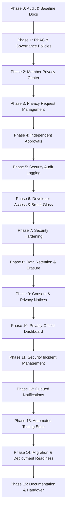

# Privacy Governance & Security Upgrade Implementation Plan
**PMCC-UK Laravel Application – UK GDPR, Privacy Governance & Security Upgrade**

---

## 1. Upgrade Roadmap & Implementation Phases

The upgrade is executed systematically in 15 distinct, verifiable phases. Every phase builds upon the existing codebase without rewriting working features or disrupting production operations.

---

## 2. Phase-by-Phase Technical Specifications

### Phase 1: Data Governance & Access Control (RBAC)
- Create database migrations for `roles`, `permissions`, `role_permissions`, `admin_roles`.
- Seed standard organizational roles: Super Administrator, President, Secretary, Treasurer, Membership Administrator, Privacy Officer, Committee Member, Developer, Member.
- Seed granular permissions (`members.view.own`, `members.view.assigned`, `members.view.sensitive`, `members.update`, `members.export`, `privacy.requests.review`, `audit.logs.view`, `security.access.grant`, etc.).
- Implement Laravel authorization Policies: `MemberPolicy`, `PrivacyRequestPolicy`, `SecurityIncidentPolicy`, `ExportPolicy`.
- Update `Admin` model with role & permission helper methods (`hasPermission()`, `hasRole()`).

### Phase 2: Member Privacy Center
- Upgrade `App\Models\Member` to extend `Illuminate\Foundation\Auth\User as Authenticatable` and add `password` support.
- Implement Member authentication routes (`/member/login`, `/member/logout`) with password and OTP recovery.
- Build responsive Member Privacy Center UI at `/member/privacy`:
  1. Personal Information Review & Correction Request.
  2. Family Dependents Information View (strictly authorized scope).
  3. Original Registration Record access & download.
  4. "Download My Data" Subject Access Request (JSON, CSV, PDF).
  5. Rectification Request with field-level change history.
  6. Data Erasure Request (with explicit disclaimer that erasure does not cancel active membership).
  7. Privacy Request History & Real-time Status Tracker.

### Phase 3: GDPR Privacy Request Management
- Create migrations for `privacy_requests`, `privacy_request_items`, `privacy_request_actions`, `privacy_request_approvals`, `privacy_request_documents`, `privacy_request_status_history`.
- Implement `StatutoryDeadlineCalculator` service enforcing UK ICO 1-calendar-month calculation, bank holiday offsets, and legitimate 2-month complex request extensions.
- Support request types: Subject Access Requests, Rectification, Erasure, Restriction of Processing, Objection, Data Portability, Consent Withdrawal, Privacy Complaints.
- Neutral handling of complex member complaints without hardcoded names or pre-judged outcomes.

### Phase 4: Independent Approval Workflow
- Build Privacy Officer review pipeline: Submitted → Identity Review → Data Discovery → Legal Review → Approval → Fulfilment → Completed.
- Separation of duties: Prevent users from approving their own requests or data exports.
- Restrict bulk member data exports behind dual-authorization.
- Disallow developers from acting as Privacy Officers.

### Phase 5: Audit Logging & Accountability
- Create `security_audit_logs` table.
- Implement `SecurityAuditService` recording actor, action, resource, IP, user-agent, justification, outcome, and request correlation ID.
- Mask sensitive personal data in logs (no passwords, full card details, or unnecessary PII).

### Phase 6: Developer Access Restrictions & Break-Glass Controls
- Segregate developer roles from standard administrative roles.
- Introduce `privileged_access_grants` table for time-limited, audited Break-Glass elevation.
- Automatic expiration of elevated privileges with Telegram/WhatsApp administrative alerts.

### Phase 7: Security Hardening
- Secure or remove unauthenticated diagnostic routes (`/run-migrations`, `/fix-ids`, `/fix-storage`, `/clear-everything`).
- Harden `MemberApiController` authentication with cryptographic signatures and rate limiting.
- Secure media downloads with signed expiring URLs (`URL::temporarySignedRoute`).

### Phase 8: Data Retention & Anonymization Engine
- Create `data_retention_policies` and `data_retention_logs`.
- Implement policy rules separating erasable operational PII from legally required financial records (6-year HMRC legal hold).
- Provide selective anonymization tools replacing PII with pseudonymous tokens (`ANON-MEMBER-XXXX`).

### Phase 9: Consent & Privacy Notices
- Create `privacy_notices` and `member_consents` tables.
- Versioned privacy notice management in admin.
- Granular consent tracking separating core membership processing (contractual necessity) from optional marketing/broadcasts.

### Phase 10: Privacy Officer Dashboard
- Build administrative UI under `/admin/privacy` using existing AdminLTE / Bootstrap 5 layout.
- Real-time KPIs: Open requests, approaching statutory deadlines, pending approvals, high-risk exports.
- Filtering, search, identity verification toggles, and secure response dispatch.

### Phase 11: Security Incident Management
- Create `security_incidents` and `security_incident_timeline` tables.
- 72-hour ICO breach assessment calculator evaluating risk to rights and freedoms of natural persons.
- Complete timeline tracking, containment logs, and ICO notification status.

### Phase 12: Notifications
- Integrate with Laravel Mail and notification system.
- Automated email notifications for request confirmation, deadline approach, review completion, and elevated access events.
- Queued dispatch with error handling.

### Phase 13: Automated Testing Suite
- Comprehensive PHPUnit feature and unit tests:
  - Unauthorized member access prevented.
  - Developer cannot view member records without elevated grant.
  - Unauthenticated routes return 401/403.
  - Signed URLs expire.
  - Statutory deadline calculation correctness.
  - Dual approval enforcement on high-risk exports.
  - Erasure does not purge financial transaction history.

### Phase 14 & 15: Migration Validation, Deployment & Documentation
- Additive database migrations executed and verified.
- Comprehensive technical and committee handover documentation in `docs/privacy-upgrade/`.
